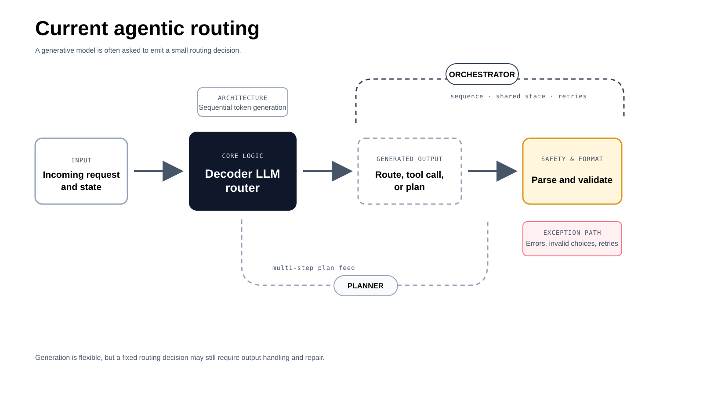
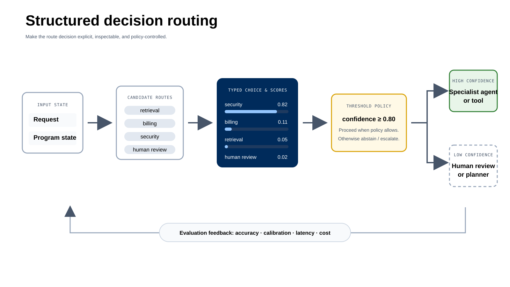

**Structured Fast Decision Models**

*Originally published in [Towards Data Science](https://towardsdatascience.com/when-all-you-have-are-decoders-every-decision-looks-like-generation/) on September 29, 2026. Republished here with permission.*

## TLDR ##

* **Not every model call needs to generate text.** Routing is often a small decision hidden inside a large agentic system, yet many systems ask a decoder language model to generate that choice token by token.
* **A decoder router is not inherently wrong.** It is useful when policy is open-ended or the route set changes rapidly. But a stable, finite route set creates a classification-shaped problem that should be measured as one.
* **The practical opportunity is a decision layer:** explicit candidate routes, typed scores, a threshold or abstention policy, and deterministic software branches.
* **The novelty is a new system primitive, not a rediscovery of classification.** Jev is a useful public example of a typed, probabilistic decision interface; its proprietary architecture and training objective are not public.
* **Efficiency and accuracy must be demonstrated, not assumed.** Compare decoder routing, an encoder-plus-head baseline, and a structured-decision implementation on the same routes, data, policies, and evaluation metrics.

---

## Contents ##

* [The Decision Layer Beyond Next Token](#head-novelty)
* [The Agentic Stack: Plan, Orchestrate, Route](#head-context)
* [How Routing Became a Generation Problem](#head-current)
* [When a Decoder Is the Right Tool](#head-decoder)
* [The Classifier Baseline We Should Not Forget](#head-classifier)
* [The Decision-Layer Opportunity: Faster, Cheaper, More Measurable](#head-structured)
* [From Labels to Decisions: The New Workflow](#head-workflow)
* [Jev: A Public Example of a Decision-First Model](#head-jev)
* [Prove It in the Workflow](#head-evaluation)
* [Make Generation Earn Its Keep](#head-final)
* [References](#references)

---

## The Decision Layer Beyond Next Token  ##

The dominant mental model of modern AI is generative: provide a prompt, then let a decoder predict the next token, and the next, until it produces an answer. That is an extraordinary capability, but it is not the only useful form of machine intelligence. Many actions inside an agentic system are not requests for prose at all. They are bounded operational questions: Which specialist should receive this case? Is the evidence sufficient to proceed? Should the system act, escalate, or abstain?

This has never sat right with me: a bounded yes/no or routing decision was often passed through the same autoregressive decoder used to generate a paragraph. I had been looking for a way to bring discriminative scoring back into the stack, but a fixed classifier head does not naturally accommodate the changing candidate sets and decision shapes real workflows need. The recent Jev discussion makes that design feel newly practical, though it still has to earn its claims in evaluation.

For those questions, the useful object is closer to <i>p</i>(decision \| state, candidates, context) than to <i>p</i>(next token \| previous tokens). A **decision layer** evaluates an explicit candidate set, returns typed scores or probabilities, applies a threshold or abstention policy, and hands a valid result to deterministic software. In other words, it turns a hidden prompt behavior into a measurable software contract.

<strong>In plain English:</strong> Read <i>a</i> &#124; <i>b</i> as “about <i>a</i>, given <i>b</i>.” The left side is what the model estimates; the right side is the information it uses. Here, the model estimates which decision fits the current state, candidates, and context.

This does not make discriminative modeling new, nor does it establish that Jev's undisclosed architecture is an encoder classifier. The new and useful proposition is a system primitive built around decisions rather than strings: fast, uncertainty-aware outputs that can sit alongside generative models in production. A planner can still create an unfamiliar plan; an orchestrator can still manage state and retries; a decision layer can handle the repeated, bounded choice between them. Jev is a public example of this direction, but the argument here is broader than any one product.

---

## The Agentic Stack: Plan, Orchestrate, Route  ##

Agentic systems are often described as though they contain one intelligence that simply “figures out what to do.” In practice, most production designs divide that work. A **router** selects a tool, specialist agent, or handling path. An **orchestrator** carries state, ordering, retries, and handoffs across the workflow. A **planner** turns a larger goal into intermediate tasks. Tool-using language-model patterns such as ReAct make that loop explicit: reasoning, action, observation, and another decision [[1](#ref-react)]. Planning methods add a decomposition stage before execution [[2](#ref-plan-solve)].

Those components solve different problems. The planner may need broad generative reasoning. The orchestrator may need ordinary deterministic code. The router may need only to answer a question such as: “Is this request for retrieval, billing, security, or human review?”

That last question is the focus here. It is not a request to write prose. It is a decision over a finite candidate set. Treating it as an unconstrained text-generation task can be convenient, but convenience is not the same as an optimal system design.

## How Routing Became a Generation Problem  ##

A common pattern supplies a decoder language model with a prompt, a catalog of tools or agents, and a request. The model emits a label, JSON object, function call, or multi-step plan. The surrounding application parses the output, validates it against a schema, retries when it is malformed or out of policy, then calls the chosen component.

  
   
  Figure 1: In a common agentic stack, a generated routing output is subsequently parsed, validated, and repaired before it can control software.

 

This pattern has real strengths. A general-purpose decoder can interpret a new policy written in natural language, cope with a long-tail request, and explain its choice to a human. It can also produce a plan rather than a single route when the problem genuinely requires one.

But the same flexibility introduces costs when the task is small and stable. Decoder language models generate sequentially: each token depends on the preceding context and generated tokens. That autoregressive design is central to language generation [[3](#ref-transformer)]. A routing label may be only a few tokens, but a reliable implementation often adds prompt instructions, structured-output constraints, validation, retries, and sometimes a second model call to judge the first. The total route is therefore more than one label.

The concern is not that a language model cannot classify. It clearly can. The concern is architectural: are we asking a text generator to reproduce a function that has a smaller, explicit interface?

## When a Decoder Is the Right Tool  ##

The right router depends on the shape of the decision. Decoder routing is reasonable when:

* the possible actions are open-ended or change too frequently to maintain a candidate set;
* the route itself must include generated arguments, a rationale, or an executable plan;
* the system needs broad language understanding before the route can even be defined; or
* a generalist model is already the lowest-complexity solution for a low-volume workflow.

It becomes less compelling when the action set is fixed, the intended output is small, and the system needs predictable latency, cost, and failure handling. In those cases, the decision is closer to supervised classification: map a representation of the request and allowed context to scores for named classes.

<table>
  <thead><tr><th>Approach</th><th>Strengths</th><th>Costs and risks</th></tr></thead>
  <tbody>
    <tr><td><strong>Decoder LLM router</strong></td><td>Flexible policy interpretation; can handle open-ended language; can generate plans and explanations.</td><td>Sequential inference; prompt sensitivity; parsing and validation; generated output can exceed the decision needed.</td></tr>
    <tr><td><strong>Encoder + classification head</strong></td><td>Direct score for each known route; compact output; familiar supervised evaluation; efficient fixed-label inference.</td><td>Requires labels and a stable task definition; route changes require data, retraining, or explicit candidate handling.</td></tr>
    <tr><td><strong>Structured decision interface</strong></td><td>Typed candidates, visible scores, threshold policy, abstention, and deterministic integration.</td><td>Its quality still depends on the model, candidate set, calibration, and evaluation; it is not a substitute for evidence.</td></tr>
  </tbody>
</table>

The trade-off matters because “agentic” is not a license to abandon fundamentals. An agent can use a decoder for planning and language interaction while using a narrower decision component for routing. The system should allocate its expensive generative capacity to the parts that need it.

## The Classifier Baseline We Should Not Forget  ##

Classical text classification often uses an encoder to map an input into a contextual representation, followed by a prediction head that scores a predefined label set. BERT is a well-known example of a bidirectional encoder that is fine-tuned with small task-specific output layers [[4](#ref-bert)]. For a router, the classes could be `retrieval`, `billing`, `security`, `scheduling`, and `human_review`.

Classification-based routing is not new. Its practical constraint has often been the static shape of the output head: one output dimension for each class in a predefined ontology. When routes are added, retired, split, or given richer context-dependent meanings, the labels, data, and training procedure may all need to change. A fixed classifier can be exactly right for a stable route set; it becomes awkward when the decision itself must range over candidates supplied by the current workflow.

Let the input state be <i>x</i>, and let <i>D</i> be the allowed route set. A classifier produces a score for each candidate:

  <i>s</i>(<i>d</i> &#124; <i>x</i>), &nbsp; <i>d</i> &isin; <i>D</i>

<strong>In plain English:</strong> For each allowed route <i>d</i>, score it using the current input <i>x</i>. <i>D</i> is the full list of routes the system is allowed to choose from.

The system can select the top score, require a margin between the first and second choices, or abstain. This is useful because it moves routing from an implicit prompt behavior to an object that can be logged and evaluated.

The baseline has limits. A classifier cannot rescue an ill-defined route taxonomy. It may fail on new routes, distribution shift, ambiguous labels, or sparse training examples. It can be poorly calibrated even when its top-1 accuracy is strong [[5](#ref-guo)]. It is therefore not enough to replace one model with another; the route definitions, data, policy, and measurement must become explicit. A decision-oriented interface may score a caller-supplied candidate set, but it does not make candidate construction, provenance, or missing options disappear; those are separate problems.

## The Decision-Layer Opportunity: Faster, Cheaper, More Measurable  ##

The possible gain is not merely a smaller output payload. In an autoregressive route, even a short label sits inside a larger generation loop: prompt construction, sequential decoding, schema enforcement, parsing, validation, and sometimes repair or retry. A decision-oriented component can instead return the bounded values that the workflow needs in one typed response. When that implementation genuinely avoids sequential text generation, it creates a plausible path to lower latency and lower cost per route.

More important, typed probabilities make a different kind of performance visible. A system can route automatically only above a confidence threshold, require a margin between the top choices, or abstain into a human or generative fallback. That can improve the *quality of automated actions* even when a model's raw top-1 accuracy is unchanged: the system chooses to automate fewer ambiguous cases. The relevant outcome is therefore not only model accuracy, but calibrated risk, coverage, retries, and downstream workflow success.

These are possibilities, not guarantees. A poor candidate set, weak calibration, or an expensive decision model can erase the advantage. The right claim is that decision-first systems give teams a cleaner surface on which to measure—and potentially improve—latency, cost, accuracy, and safe automation.

## From Labels to Decisions: The New Workflow  ##

The design I am proposing is broader than “always use an encoder.” It is a routing contract:

1. Define the routes that are allowed for this decision.
2. Provide the model with the relevant request and program state.
3. Receive a typed choice and a score for each candidate, or at minimum a score for the selected candidate and its alternatives.
4. Apply a versioned policy: route automatically, abstain, or send the request to a slower planner or human reviewer.
5. Log the candidate set, scores, policy version, selected route, outcome, latency, and cost.

  
   
  Figure 2: The proposed routing contract makes the candidates, uncertainty policy, execution branch, and evaluation surface explicit.

 

Suppose a support request has candidate routes <i>D</i> = {retrieval, billing, security, human review}. A structured decision layer could produce `security: 0.82`, `billing: 0.11`, `retrieval: 0.05`, and `human review: 0.02`. A policy might route automatically only when the top score exceeds 0.80, the margin is large enough, and no safety rule blocks automation. Otherwise it abstains.

That abstention is a feature, not a failure. Selective prediction makes the coverage–risk trade-off measurable: a system can answer fewer cases automatically in exchange for lower error on the cases it does answer [[6](#ref-selectivenet)]. For routing, the fallback can be a person, a slower planner, or a more capable generative model.

This approach can reduce work per decision because it avoids generating and repairing output that the workflow does not need. It can improve route quality only if the scores, candidates, and policy are better for the workload. Those are empirical claims, not properties guaranteed by the diagram.

## Jev: A Public Example of a Decision-First Model  ##

Jev, TypeSafe AI's public decision-first model, is a useful example of a product designed around this narrower interface. TypeSafe calls this model category **System One**—also written **System 1**—and describes Jev as taking state and returning typed probabilistic decisions, with parallel evaluation rather than autoregressive token-by-token output [[7](#ref-jev-launch)]. Its documented primitives include **Choice** for a caller-supplied option set, **Score** for ordered levels, and **Noul** for a yes/no probability [[8](#ref-jev-primitives)]. TypeSafe also calls its training approach Reinforcement Learning for Calibrated Decisions (RLCD) [[7](#ref-jev-launch)].

These public statements support a discussion of the *interface*: explicit choices, typed outputs, scores, and software-controlled uncertainty policies. They do not disclose enough to reconstruct Jev's backbone, parameterization, corpus, loss function, reward, or exact internal scoring procedure. This post should not claim that Jev is an encoder classifier, or that the proposed architecture below is Jev's architecture.

Jev is not the only option for builders. Laya is an open research approach that starts with a fixed, predefined candidate set, making conditioning, scores, calibration, and abstention inspectable. Across approaches, the same boundary applies: making selection measurable does not remove the need to define candidates, record their provenance, or handle missing options.

The relevant comparison is functional. A structured-decision system can expose an action set and uncertainty in a form an orchestrator can consume directly. TypeSafe reports latency, cost, and workflow-quality comparisons for its own System One-shaped workloads, while also noting that its published gains can be on the high end and that its workflow authors may introduce bias [[7](#ref-jev-launch)]. Those are useful hypotheses to test in a routing system, not universal performance guarantees.

## Prove It in the Workflow  ##

A serious routing comparison should use the same requests, route definitions, downstream tools, and fallback policy for all approaches. At minimum, compare:

* a prompted decoder LLM router with structured-output validation;
* an encoder-plus-classification-head baseline for a fixed route set; and
* a structured-decision implementation with explicit candidates, scores, and abstention.

Report more than top-1 routing accuracy:

* **Route quality:** accuracy, macro-F1 where routes are imbalanced, confusion matrices, and the cost of a wrong route.
* **Uncertainty:** calibration curves, Brier score or log loss where probabilities are meaningful, and selective risk at each abstention threshold.
* **Operations:** p50 and p95 latency, total cost per routed request, retry rate, schema-validation failures, and fallback rate.
* **Robustness:** policy changes, new or retired routes, adversarial inputs, ambiguous requests, and distribution shift.

The winner may differ by workflow. A decoder may remain best when the decision is genuinely generative. A fixed classifier may be best for stable, high-volume labels. A structured-decision model may offer a useful middle path when the system needs flexible semantic decisions but must expose them as reliable, measurable software inputs.

## Make Generation Earn Its Keep  ##

Agentic systems do not need one model type for every step. Planning, explanation, retrieval synthesis, and conversational interaction can benefit from generation. Routing often has a different shape: choose among allowed actions under latency, cost, and safety constraints.

The practical shift is to make that decision visible. Define the candidates. Score them. State when the system may act. State when it must abstain. Then measure the result against the generative baseline rather than assuming that more generation means better agency.

That is the opportunity suggested by structured decision interfaces such as Jev: not magic routing, and not a reason to discard encoder classifiers, but a more disciplined way to decide where agentic systems should spend their intelligence.

---

**Structured Fast Decision Models**

---

## References  ##

<a name="ref-react" href="https://arxiv.org/abs/2210.03629" target="_blank">[1]</a>
Yao, S., Zhao, J., Yu, D., et al. (2023). ReAct: Synergizing Reasoning and Acting in Language Models. *ICLR*.

<a name="ref-plan-solve" href="https://arxiv.org/abs/2305.04091" target="_blank">[2]</a>
Wang, L., Xu, W., Lan, Y., et al. (2023). Plan-and-Solve Prompting: Improving Zero-Shot Chain-of-Thought Reasoning by Large Language Models. *ACL*.

<a name="ref-transformer" href="https://arxiv.org/abs/1706.03762" target="_blank">[3]</a>
Vaswani, A., Shazeer, N., Parmar, N., et al. (2017). Attention Is All You Need. *NeurIPS*.

<a name="ref-bert" href="https://aclanthology.org/N19-1423/" target="_blank">[4]</a>
Devlin, J., Chang, M.-W., Lee, K., &amp; Toutanova, K. (2019). BERT: Pre-training of Deep Bidirectional Transformers for Language Understanding. *NAACL-HLT*.

<a name="ref-guo" href="https://proceedings.mlr.press/v70/guo17a.html" target="_blank">[5]</a>
Guo, C., Pleiss, G., Sun, Y., &amp; Weinberger, K. Q. (2017). On Calibration of Modern Neural Networks. *ICML*.

<a name="ref-selectivenet" href="https://proceedings.mlr.press/v97/geifman19a.html" target="_blank">[6]</a>
Geifman, Y., &amp; El-Yaniv, R. (2019). SelectiveNet: A Deep Neural Network with an Integrated Reject Option. *ICML*.

<a name="ref-jev-launch" href="https://typesafe.ai/blog/introducing-system-one-models-and-jev" target="_blank">[7]</a>
Almeida, D. (2026, September 15). Introducing System One Models &amp; Jev. TypeSafe AI blog. Vendor source for Jev's public interface, sampling, training-label, and reported workflow comparisons.

<a name="ref-jev-primitives" href="https://docs.typesafe.ai/primitives.md" target="_blank">[8]</a>
TypeSafe AI. (2026). Primitives. TypeSafe AI documentation. Documents Choice, Score, and Noul interfaces.
